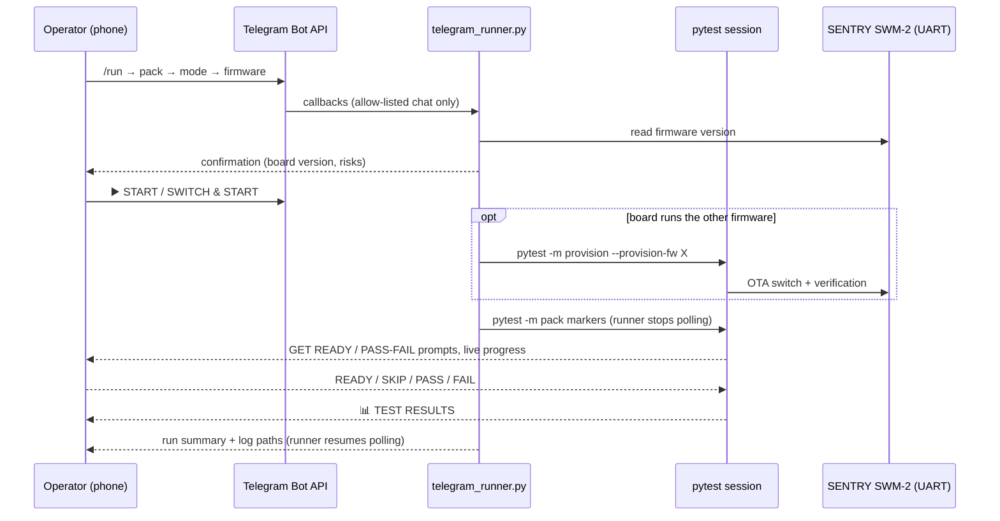

# DZ17 — SENTRY SWM-2 Acceptance Testing & Autotests

This package implements automated and interactive pytest test suites and bench procedures for **SENTRY SWM-2 (fw_7)**, based on [`../fw_7/PRD.md`](../fw_7/PRD.md), [`../fw_7/HW-17.md`](../fw_7/HW-17.md), and manual check baselines in [`REPORT.md`](REPORT.md) and [`TEST_PLAN.md`](TEST_PLAN.md).

## Test Suite Architecture

```
dz17/
├── config/
│   ├── test_config.py          # Credential resolution (env vars, secrets, CLI overrides)
│   ├── wifi_config.py          # Wi-Fi and UART configuration compatibility facade
│   ├── secrets.example.py      # Template for local credentials
│   └── secrets.py              # Local credentials (git-ignored)
├── drivers/
│   └── device_driver.py        # SENTRY SWM-2 UART driver (parsers for [BEACON], [LINK], [SONAR], [VALVE], etc.)
├── manual_checks.py            # Operator preparation prompts (manual_prepare) and verification (manual_check)
├── telegram_runner.py          # Bench-PC Telegram bot that starts allow-listed test packs
├── utils/
│   └── telegram_helper.py      # Synchronous Telegram Bot API interaction client
├── pytest.ini                  # Pytest markers and default exclusion of interactive & persistent tests
├── conftest.py                 # Fixtures: firmware/UART lifecycle and Beacon state teardown
├── tests/
│   ├── test_lamp.py            # LM-1 to LM-8, interactive lamp/status-LED observations
│   ├── lamp_test_helpers.py    # Shared lamp status, timer, power/configuration, and recovery steps
│   ├── test_lamp_helpers.py    # Unit tests for shared lamp helpers (no hardware)
│   ├── test_wifi.py            # WF-1 to WF-5 with LM-8 status-LED confirmations
│   ├── test_buttons.py         # §12: K1-K4 actions and button pairs
│   ├── test_distance.py        # DS-1 to DS-5: sonar measurement, stream, stats, filter, calibration
│   ├── test_relay.py           # RL-1 to RL-7: valve control, cycle accounting, schedule, auto, health
│   ├── test_guard.py           # Partial GD-1 to GD-3 coverage: status/zones, arming and panic
│   ├── test_alert.py           # Partial AL-1 to AL-5 coverage: generation, listing, acknowledgement, critical effects
│   ├── test_auth_registration.py # AU-1 clean-NVS registration validation and valid-profile setup
│   ├── test_device_driver_parsers.py # Unit tests for driver UART parsers (no hardware required)
│   ├── test_manual_checks.py   # Unit tests for console/Telegram manual-check routing
│   ├── test_telegram_helper.py # Offline tests for Telegram API filtering and failures
│   └── test_telegram_runner.py # Offline tests for the Telegram pack runner menu and launch
├── run.ps1                     # Main test launcher
├── run-lamp.ps1                # Lamp test launcher
├── run-wifi.ps1                # Wi-Fi test launcher
├── run-buttons.ps1             # Buttons test launcher (runs with -s)
├── run-distance.ps1            # Distance test launcher
├── run-guard.ps1               # Guard test launcher (2.3.0, -s)
├── run-alert.ps1               # Alert Center test launcher (2.3.0, -s)
├── run-auth-registration.ps1   # AU-1 provisioning pack (interactive, persistent, -s)
├── run-ota.ps1                # OTA pack for one explicitly selected firmware
└── run-ota-chain.ps1          # Detect starting firmware, test both versions, and return to start
```

## Safety & Interactive Protocol (`AGENTS.md`)

- **Interactive Test Protocol (`manual_prepare`)**:
  All tests marked `@pytest.mark.interactive` present a clear 4-part preparation prompt to the operator before any physical action or observation:
  1. **What to do**: which button to press, where to position obstacle.
  2. **What to observe**: LED color, relay click, measurement stream.
  3. **Duration / time limit**: specified time (e.g. ~5-10 s).
  4. **Confirmation**: waits for Enter before proceeding (`Press Enter when ready:`).
  5. **Skip at first prompt**: only the first preparation prompt of each test also offers a skip (`s` in the console, `⏭ SKIP TEST` in Telegram). Skipping happens before any physical action, so the whole test is reported as SKIPPED (never passed) and the decision is attached to Allure as manual evidence. Later prompts in the same test cannot skip.
  Console prompts use concise `GET READY`, `ACTION`, `OBSERVE`, and `DURATION` labels matching the Telegram operator flow. Lamp color checks show the named color, an ANSI RGB sample when supported, and the exact RGB values; `NO_COLOR`, `TERM=dumb`, and captured output retain a readable text label and RGB values without escape codes. Every operator-facing notification is separated by simple `=` dividers, with action, observation, and duration fields separated by blank lines.
- **Streaming Discipline**:
  Continuous streams (e.g. `distance log 100`, K3 sonar stream) are cleanly stopped (`distance stop` / second K3 tap) and confirmed stopped *before* prompting for manual verification.
- **Lamp RGB LED and status indication**:
  There is one RGB LED, not a separate Beacon emitter and board status LED. When lamp output is ON it shows the configured lamp color; when lamp output is OFF, the same LED shows connection/login status: RED means Wi-Fi disconnected, ORANGE means Wi-Fi connected but logged out, and GREEN means Wi-Fi connected and logged in. UART-reported state and the operator's physical observation are checked separately.
  Wi-Fi tests that inspect this status indication verify firmware and establish the configured authenticated account before Beacon inspection. After the operator confirms readiness, they query Beacon state over UART and turn it off when needed; the original lamp settings are restored afterward. Tests that require GREEN re-establish login after Wi-Fi actions if needed, and fixture teardown restores the configured login after scenarios that deliberately log out.
- **Multi-Line UART Captures**:
  UART log indexes (`mark = len(device_driver.uart_log)`) are recorded prior to prompts to avoid race conditions.
- **UART Transcript Retention**:
  With DEBUG logging enabled (always for `auth` and `ota`), each test's UART transcript is saved under `logs/automated/<category>/<firmware>/`. A newer run removes older **uncommitted** transcripts of the same test and firmware. Transcripts committed to git are report evidence and are never deleted or overwritten: if today's file name is already committed, the new transcript gets a time suffix (`YYYYMMDD-HHMMSS-<test>.txt`). If git is unavailable, nothing is deleted.
- **Credentials**:
  Passwords and tokens are redacted from UART transcripts, Allure attachments, and urllib3 DEBUG request URLs;
  `secrets.py` is excluded by `.gitignore`.
  Free-text manual comments are sanitized for common password/token/secret key-value formats before
  logging and display; operators should still never enter credentials or secrets in a comment.
  Copy `config/secrets.example.py` to `config/secrets.py` and set the local Wi-Fi and
  device account credentials there. Alternatively, provide account values with `HW17_USER` /
  `HW17_PASSWORD` or `TEST_USER` / `TEST_PASSWORD`; environment values override the local file.
  Do not commit or share the local secrets file.
- **AU-1 registration pack**:
  `run-auth-registration.ps1` is deliberately separate from `run-auth.ps1`. By default it uses
  COM4 and firmware 2.3.0; pass `-Port` and `-Fw` to override them when they do not match the
  bench. Before any erase, it reads the running firmware over UART and requires an exact
  typed operator authorization for the
  displayed target and command. It then runs `esptool erase-region 0x9000 0x6000`, which clears
  the complete NVS partition (including the saved account, Wi-Fi profile, and settings) while
  leaving firmware installed. Declining authorization skips the pack without erasing anything;
  after success, each test's UART fixture verifies the expected firmware.
  AU-1 negative checks are separate pytest cases, parameterized by invalid input. Each case gets
  its own UART lifecycle and verifies Wi-Fi/logged-out preconditions. A module-scoped fixture
  validates configuration, obtains consent, and erases NVS exactly once before the cases start.
  Negative cases run first and never attempt registration; the final positive case creates the
  configured profile and confirms login. The created account remains persistent after the run.
  It may save the configured Wi-Fi profile and always
  leaves a successfully created account persistent (typically logged in). Provide the configured
  Wi-Fi and account credentials through the local secrets file or environment; never enter them
  in the operator prompt. The password length must be 6-32 characters. If firmware unexpectedly
  accepts an invalid registration, that case fails and later registration checks may also fail
  because the device permits only one profile; no cleanup erase is performed. Rerun the pack and
  explicitly authorize a fresh NVS erase before retrying. Whitespace-containing usernames are not included because the CLI's token parser
  returns E201 usage and the PRD does not define a quoting/escaping syntax.
- **Telegram (optional)**: operator prompts, starting packs from the chat, firmware precondition, and
  results reporting are described in [Telegram Remote Control](#telegram-remote-control).
- For DZ17-specific pitfalls and evidence boundaries—including the shared RGB LED, prompt cues, Telegram
  response matching, and `-All` selection—see the
  [DZ17 gotchas](../.agents/skills/interactive-hardware-tests/references/dz17-gotchas.md).

## Telegram Remote Control

> **Status (2026-10-28):** implemented as part of this course project and covered by offline unit tests
> (fake Telegram API and fake board). Used on the real bench and bot: Lamp and Auth packs run from the chat,
> operator prompts, stopping a run, and the full 🔄 OTA chain from 2.1.0. After the 2026-10-28 driver fix, both
> OTA transitions (2.1.0 → 2.3.0 and 2.3.0 → 2.1.0) passed. **Not yet confirmed on the bench:** retry behaviour
> during a real Telegram outage, the 🆕 Registration pack, and the full set of other packs and modes. These
> bench runs are Telegram tool checks. Only the OTA-9 retest on 2.3.0 is kept as report evidence; the other
> logs stay out of the repository.

Interactive hardware tests need a person next to the board: to press K1–K4, place an obstacle, or judge
an LED color. The console works when that person also sits at the PC. The Telegram integration lets
the operator stay at the bench with only a phone: they can answer prompts, start test packs, and get
the results in one private chat.

It works on two levels:

1. **Operator channel**: any pytest run can send its preparation prompts and manual checks to Telegram
   instead of the console (`INTERACTION_MODE=telegram`, or `-InteractionMode telegram` on every launcher).
2. **Remote runner**: [`telegram_runner.py`](telegram_runner.py) is a small bot process on the bench PC.
   It starts allow-listed test packs from the chat, switches firmware first when needed, and reports
   the outcome.



### Components

| File | Responsibility |
|---|---|
| [`utils/telegram_helper.py`](utils/telegram_helper.py) | Synchronous Bot API client: messages, inline buttons, color swatches, polling, private-chat allow-list, token redaction, and retries for temporary API errors. |
| [`manual_checks.py`](manual_checks.py) | Routes `manual_prepare` / `manual_check` / distance input to the console or Telegram and records operator answers as Allure evidence. |
| [`conftest.py`](conftest.py) | Live status message, results tally and final report, the "skip at first prompt" fixture logic, and the `--provision-fw` precondition selection. |
| [`telegram_runner.py`](telegram_runner.py) | Bench bot: `/run` menu, fixed pack and mode table, firmware detection, provisioning, launching pytest, and run summary. |
| [`tests/test_ota.py`](tests/test_ota.py) `::test_provision_requested_firmware` | Firmware-switch precondition (OTA), selected only by `--provision-fw`. |

### Setup

1. Create a bot with `@BotFather`, open its private chat, and send `/start`.
2. Copy [`config/secrets.example.py`](config/secrets.example.py) to the git-ignored `config/secrets.py`
   and set `TELEGRAM_BOT_TOKEN` and your numeric private-chat `TELEGRAM_CHAT_ID` (same-named
   environment variables override them). Never put the token in tracked files, output, or command history.
3. Optional: `TELEGRAM_TIMEOUT` sets how long a prompt waits for an answer (default 300 s);
   `DZ17_PORT` sets the runner's default UART port (default `COM4`).

### Use 1: Telegram as the operator channel for a launcher run

```powershell
cd dz17
.\run-lamp.ps1 -InteractionMode telegram -All -Fw 2.3.0
```

The launcher sets `INTERACTION_MODE` for the pytest process only and restores your previous value
afterwards. Telegram mode does not need `-s`.

### Use 2: start packs from the chat

```powershell
cd dz17
.\.venv\Scripts\python.exe telegram_runner.py --port COM4
```

Keep this window open. In the chat, use `/run` to choose a pack, `/stop_execution` to stop a running pack, `/status` to check that the runner
is idle, and `/help` to see the rules. The flow is **pack → mode → firmware → confirmation → ▶️ START**.

| Mode | Marker selection (within the pack) | Operator needed | Persistent effects |
|---|---|---|---|
| 🤖 Automated | `not interactive and not persistent` | No | No |
| 🙋 Interactive | `interactive and not persistent` | Yes | No |
| ⚠️ Persistent | `persistent` | Sometimes | **Yes** |
| 🧩 All | whole pack (same scope as the launchers' `-All`) | Yes | **Yes** |

| Pack | 🤖 | 🙋 | ⚠️ | 🧩 |
|---|:-:|:-:|:-:|:-:|
| 🔘 Buttons | | ✓ | ✓ | ✓ |
| 💡 Lamp | | ✓ | ✓ | ✓ |
| 📶 Wi-Fi | ✓ | ✓ | ✓ | ✓ |
| 📏 Distance | ✓ | ✓ | ✓ | ✓ |
| 🚨 Guard | ✓ | | ✓ | ✓ |
| 🔔 Alert | ✓ | | ✓ | ✓ |
| 🔐 Auth | ✓ | ✓ | ✓ | ✓ |
| 🔌 Relay (every test is persistent) | | | ✓ | |
| 🧪 All packs | ✓ | | | ✓ |

Two packs have their own plans instead of the modes above:

| Pack | Mode | What runs |
|---|---|---|
| 🔄 OTA | 🔁 Full chain | Same as `run-ota-chain.ps1 -All`. There is no firmware menu: the runner reads the running firmware and starts from it, and if the board does not report 2.1.0 or 2.3.0 there is no START button. (1) OTA checks on the starting firmware, (2) switch to the other version, (3) its checks, (4) switch back. Each stage is a separate pytest session. Between stages, the runner reads the firmware over UART and stops the chain if it is not the expected version. The checks include the interactive Wi-Fi interruption / download-retry test. |
| 🔄 OTA | 🧪 Checks only | Stage 1 only: OTA checks on the running firmware, with no version change. |
| 🆕 Registration (AU-1) | ⚠️ Erase NVS + register | Same as `run-auth-registration.ps1`. NVS is erased only after the exact consent phrase is typed in the chat. Negative cases run first, and the last case creates the configured account. |

Modes are only offered where the pack has matching tests. The confirmation screen shows the board's
detected firmware, the port, the selection (marker expression or OTA stages), and whether the operator or
persistent state is involved. The runner then calls pytest directly, not the `run-*.ps1` scripts:
`run-alert.ps1` and `run-ota-chain.ps1` wait for `Read-Host`, which would block a run started from the chat.
Logs and JUnit go to the usual `logs/automated/<pack>/<fw>/` folders as
`run-<timestamp>-telegram-<pack>-<mode>.log` / `-junit.xml`, and OTA stages go to
`logs/automated/ota/<fw>/run-<timestamp>-telegram-ota-<NN>-<stage>.log`.

**Never run from the chat** (console-only): full alert-history cleanup and long-range (>4 m) sonar checks.
"🧪 All packs" also leaves out OTA and AU-1 registration; start those through their own packs.

### Operator prompts in the chat

- **🧰 GET READY**: action, what to observe, and duration, confirmed with ✅ READY. The **first** preparation
  prompt of each test also offers **⏭ SKIP TEST**. Choosing it skips the whole test before any physical action.
  The test is reported as SKIPPED (never passed), and the decision is attached to Allure. Later prompts
  in the same test cannot skip. In the console the same choice is `s`.
- **👀 Manual check**: ✅ PASS / ❌ FAIL / 📝 ADD NOTE. Lamp color checks also send a PNG reference swatch with the
  expected RGB. The swatch is only a reference; the operator judges the physical LED.
- **Text input**: measured distances and typed consent phrases for destructive actions. These are accepted
  as a reply to the prompt or as a new message.
- Only callbacks and messages from the configured private chat are accepted. Taps on older prompts are ignored.
- **Stopping a run**: send **`/stop_execution`** (listed in the bot's "/" menu) or tap **⏹ STOP RUN** on the
  status message. Prompts have no STOP button, so it cannot be hit by accident next to READY or PASS.
  Both work like Ctrl+C in the console: the session stops at
  the current prompt or, during a test without prompts, before the next test starts. `finally` blocks and fixture
  teardown still run, the interrupted prompt is marked **⏹ RUN STOPPED BY OPERATOR**, and the 📊 report lists
  how many selected tests did not run. Use it when a trivial setup issue makes the rest of the pack pointless.
  - The command also works while a prompt waits for a text reply, where it is never taken as the answer.
  - A stop sent during an OTA firmware switch takes effect when the switch ends: the pack is not started.
  - Stop requests left over from an earlier run are dropped when a Telegram session starts, so they cannot stop
    the next run. With no run active, the runner answers *No run is active*.
  - The stop is a `KeyboardInterrupt` subclass, so the `except Exception` cleanup blocks in tests cannot swallow it.

### Firmware precondition

After you choose the firmware, the runner reads the running version over UART:

| Board reports | Confirmation shows | On START |
|---|---|---|
| requested version | `Board: 2.3.0 ✅ matches` | pack runs |
| the other supported version | `Board: 2.1.0 → needs OTA to 2.3.0`, ⚠️ warning, **▶️ SWITCH & START** | OTA switch, then pack |
| no answer | `firmware not detected` | pack runs; its firmware check decides |
| unsupported version | `⛔ unsupported firmware` | pack runs and fails its firmware check; no OTA |

The switch runs as a separate pytest session (`-m provision --provision-fw <fw>`) that reuses the normal
Wi-Fi/login fixtures. It first makes sure `ota server` is the default (OTA error tests point it at a local
server), then uses the validated OTA paths: `ota update beta` for 2.1.0 → 2.3.0, and
`ota install 2.1.0 force` for 2.3.0 → 2.1.0. Both use the full OTA success, self-check, and partition
assertions. If the switch fails, the chat shows **⛔ RUN BLOCKED — precondition failed** with the log path,
and the pack is not started. A failed switch is an unmet precondition, not a product defect. Every pack still
runs with `--expected-fw-version` as the final guard. The provisioning test is deselected from every run
unless `--provision-fw` is given, and then it runs alone. The run log, JUnit, and UART transcript are kept
together in `logs/automated/provisioning/<starting fw>/`, and file names include the target version.

### Progress and results

One status message is edited as the run progresses:

```
🧪 TEST IN PROGRESS (6/31)
Beacon named color: PURPLE

✅ 3 · ❌ 1 · ⚪ 1
```

When the session ends, a separate report is posted. With the runner, it is followed by the pytest exit
status and the log paths:

```
📊 TEST RESULTS
━━━━━━━━━━━━━━━━━━
🧪 Run: 31 of 31 selected
✅ Passed: 25
❌ Failed: 3
⚪ Skipped: 2
🟠 XFAIL (known defects): 1
⚠️ XPASS (unexpected pass): 0
⏱ Duration: 12m 04s

❌ Needs attention:
• <failed or XPASS test names, first 15>
```

### Reliability

On 2026-10-28, Telegram itself returned `429 Too Many Requests` and `502 Bad Gateway` during a Lamp run.
That outage shaped these rules:

- Temporary API errors (429, 500/502/503/504, network failures) are retried up to 4 attempts. A 429 waits
  for Telegram's `retry_after`, and other errors back off 1 → 2 → 4 s (at most 30 s per wait). Errors such
  as 401 are not retried. Sending a message or photo is retried only after a 429: after a 5xx or a dropped
  connection, Telegram may already have delivered it, and a resent duplicate prompt would have dead buttons.
- If a prompt is still lost after the retries, its message is edited to **⚠️ TELEGRAM CONNECTION LOST**, so
  the old buttons do not look active. The test fails with the API error, which is not a product defect.
- Status and report messages are best effort: an outage logs a warning but can never abort the pytest
  session or change its outcome.
- The runner stays online during outages (it pauses 15 s and polls again) and always prints the run
  summary to its console.
- Only one process polls the bot at a time. The runner clears queued updates and stops polling while
  pytest runs, then clears them again before it resumes.

### Safety

- Chat input only selects entries from the fixed tables in `telegram_runner.py`. Callback data is
  validated against them, and nothing typed in the chat reaches the command line.
- A START button works only on the current menu message; old menus cannot start a run.
- Persistent modes, 🧩 All, and firmware switches are shown with explicit warnings and need a deliberate tap.
  Credentials always come from `config/secrets.py` or the environment, never from the chat, and the
  bot token is redacted from logs.
- One run at a time.

### Limitations

- Stopping is not immediate during a long test without prompts: it takes effect before the next test.
  Ctrl+C in the runner window still aborts at once, but it also stops the runner.
- Do not run a separate `-InteractionMode telegram` pytest session with the same bot while the runner
  is online, because two pollers would steal each other's updates.
- Firmware switching uses OTA only and covers 2.1.0 ↔ 2.3.0. It does not flash with esptool and cannot
  recover a board that does not boot or runs unsupported firmware.
- No automatic switch back after the pack: the board stays on the requested firmware.
- The PowerShell launchers do not have the firmware precondition yet. It is available only through the runner
  or directly with `pytest -m provision --provision-fw <fw> --port COMx`.

### Offline tests

```powershell
.\.venv\Scripts\python.exe -m pytest tests/test_telegram_runner.py tests/test_telegram_helper.py tests/test_manual_checks.py tests/test_firmware_version_setup.py
```

These cover menu flow and allow-list rejection, the marker expressions, the provisioning and blocked
paths, the retry and backoff rules, outage handling, the results tally, and skip-at-first-prompt.
None of them touch the board or the real Bot API.

## Test Execution

### Configuration locations

| Setting | Where to configure it |
|---|---|
| Test selection defaults and marker definitions | [`pytest.ini`](pytest.ini). By default, pytest excludes tests marked `interactive`, `ota`, or `persistent`. |
| UART port, baud rate, expected firmware | [`conftest.py`](conftest.py): `--port`, `--baudrate`, `--expected-fw-version`. Hardware launchers default to `COM4`; pass `-Port` and `-Fw` to set the target explicitly. Direct pytest defaults to 115200 baud and detects a unique ESP32 port if `--port` is omitted. |
| Launcher defaults and run options | The relevant [`run-*.ps1`](.) script. Main/lamp/Wi-Fi/buttons/distance launchers default to firmware 2.1.0; Guard, Alert, and Relay default to 2.3.0. |
| Wi-Fi, device account, and Guard PIN | Copy [`config/secrets.example.py`](config/secrets.example.py) to the git-ignored `config/secrets.py` and set `DEFAULT_WIFI_SSID`, `DEFAULT_WIFI_PASSWORD`, `DEFAULT_APP_USER`, `DEFAULT_APP_PASSWORD`, and (for Guard alarm tests) the four-digit `DEFAULT_GUARD_PIN`. Environment alternatives: `HW17_WIFI_SSID` / `HW17_WIFI_PASSWORD` or `TEST_WIFI_SSID` / `TEST_WIFI_PASSWORD`, `HW17_USER` / `HW17_PASSWORD` or `TEST_USER` / `TEST_PASSWORD`, and `HW17_GUARD_PIN`. Per-run pytest options: `--wifi-ssid`, `--wifi-password`, `--app-user`, `--app-password`. |
| Invalid Wi-Fi scenario inputs | `HW17_WIFI_WRONG_PASSWORD` (or `TEST_WIFI_WRONG_PASSWORD`) and `HW17_WIFI_MISSING_SSID` (or `TEST_WIFI_MISSING_SSID`) in the local environment. |
| Operator interaction channel | `INTERACTION_MODE=console` (default) or `telegram`; launchers accept `-InteractionMode console\|telegram`. See [Telegram Remote Control](#telegram-remote-control). |
| Generated logs and test results | `logs/automated/<category>/<firmware>/`: dated run logs and JUnit XML from the launchers, and per-test UART transcripts when DEBUG logging is enabled (always for `auth` and `ota`). |

Credential precedence: per-run CLI override, then `HW17_*`, then `TEST_*`, then `config/secrets.py`.
Never commit or share credentials; they are redacted from UART and Allure evidence.

**Connectivity and login preconditions.** Before every authenticated test, the fixture verifies the
Wi-Fi connection and IP, even when a session is already active. When a test SSID is configured, the
connected SSID must match it. The fixture tries `reconnect` with the saved profile first, then falls back
to `connect` with the configured SSID and password, which can save or replace the device's persistent
Wi-Fi profile. It then confirms `whoami` and, if needed, logs out a different account and logs in the
configured one. Tests that start from a deliberately disconnected or logged-out state use the
lower-level `device_driver` fixture and set up only what they need. The authenticated fixture leaves the
session logged in after the test.

### 1. Run Unit Tests (No hardware required)
```powershell
python -m venv .venv
.\.venv\Scripts\python.exe -m pip install -r requirements.txt
.\.venv\Scripts\python.exe -m pytest tests/test_device_driver_parsers.py tests/test_manual_checks.py tests/test_telegram_helper.py tests/test_telegram_runner.py
```

All DZ17 PowerShell launchers use the isolated `dz17\.venv`; run the setup above from the `dz17`
folder before using a launcher.

### 2. Run Automated Hardware Suites (Non-interactive, non-persistent)
```powershell
# All automated tests on COM4 against FW 2.1.0
.\run.ps1 -Port COM4 -Fw 2.1.0

# Default UART-only, non-persistent subsets per package
.\run-lamp.ps1 -Port COM4 -Fw 2.1.0
.\run-wifi.ps1 -Port COM4 -Fw 2.1.0
.\run-distance.ps1 -Port COM4 -Fw 2.1.0
.\run-guard.ps1 -Port COM4          # 2.3.0 by default
.\run-alert.ps1 -Port COM4          # 2.3.0 by default
```

**`-All`** on any launcher selects every test in that scope, including interactive and persistent ones,
and enables console input (`-s`). Review the [persistent effects](#6-persistent-state-effects) first:
```powershell
.\run.ps1 -Port COM4 -Fw 2.3.0 -All     # whole suite, including the AU-1 registration pack
.\run-lamp.ps1 -Port COM4 -Fw 2.1.0 -All
.\run-wifi.ps1 -Port COM4 -Fw 2.1.0 -All
.\run-buttons.ps1 -Port COM4 -Fw 2.1.0 -All
.\run-distance.ps1 -Port COM4 -Fw 2.3.0 -All   # also long-range (>4 m clear path) and offline helpers
.\run-guard.ps1 -Port COM4 -Fw 2.3.0 -All
.\run-alert.ps1 -Port COM4 -Fw 2.3.0 -All      # still asks before any history cleanup
```
`run.ps1 -All` may actuate the relay, change settings, save Wi-Fi configuration, add alert-history
entries, and, after a separate typed authorization, erase NVS for the AU-1 pack (see
[Safety](#safety--interactive-protocol-agentsmd)). It never flashes firmware.

### 2a. Run the complete OTA cycle from either supported firmware
```powershell
.\run-ota-chain.ps1 -Port COM4 -All
.\run-ota-chain.ps1 -Port COM4 -All -InteractionMode telegram
```

The chain detects 2.1.0 or 2.3.0 over UART, runs that version's OTA checks, switches to the other
version and runs its checks, then returns to the starting version. It verifies the UART-reported version
before and after each phase, gives each phase its own log and JUnit label, and asks for `OTA-CHAIN`
confirmation. `-All` is required. Use `run-ota.ps1 -Fw <version>` for the OTA pack of one firmware only.

### 3. Run Interactive Hardware Tests (Requires operator action, `-s` in console mode)
```powershell
# AU-1 registration: one typed authorization, then NVS erase; creates a persistent profile.
.\run-auth-registration.ps1 -Port COM4 -Fw 2.3.0

# Buttons (the K2 relay test actuates the relay)
.\run-buttons.ps1 -Port COM4 -Fw 2.1.0

# Lamp: UART assertions only (physical checks recorded as NOT RUN), or with operator checks
.\run-lamp.ps1 -Port COM4 -Fw 2.1.0 -Persistent
.\run-lamp.ps1 -Port COM4 -Fw 2.1.0 -ManualChecks -Persistent
.\run-lamp.ps1 -Port COM4 -Fw 2.1.0 -Interactive -Persistent -TestName "test_lamp_named_color_visual and red"
.\run-lamp.ps1 -Port COM4 -Fw 2.3.0 -TestName "test_lamp_logout_and_relogin_keeps_beacon_off"
.\run-lamp.ps1 -Port COM4 -Fw 2.3.0 -Interactive -TestName "test_lamp_status_led_connection_login_mapping"

# Wi-Fi disconnect/reconnect with status-LED confirmation (main Beacon output must be OFF)
.\run-wifi.ps1 -Port COM4 -Fw 2.1.0 -Interactive -TestName "test_wifi_disconnect"
.\run-wifi.ps1 -Port COM4 -Fw 2.1.0 -Interactive -TestName "test_wifi_reconnect"
.\run-buttons.ps1 -Port COM4 -Fw 2.1.0 -TestName "test_button_unauthenticated_blocked"

# Distance: interactive measurement sweep (repeat positions until you answer "no";
# the ±0.5 cm threshold is exploratory). -LongRangeOnly selects the >4 m case.
.\run-distance.ps1 -Port COM4 -Fw 2.1.0 -Interactive
```

**Lamp.** Each Beacon scenario asserts UART responses and readbacks; physical observations are optional.
`-ManualChecks` (alias `-Interactive`, equivalent to `--manual-checks -s`) enables the prompts.
Without it, Allure records the physical checks as NOT RUN, never as passed. The `lamp_state` fixture
captures the lamp state, enforces timer-off before each test, and restores power and settings afterwards.
Shared actions and assertions live in [`tests/lamp_test_helpers.py`](tests/lamp_test_helpers.py).
The status-LED mapping case temporarily changes Wi-Fi/login state and restores it. It needs NORMAL
state, Guard disarmed, and no higher-priority LED indication. The expected GREEN / ORANGE / RED mapping
is observed behavior, not a PRD color contract.

**Distance.** The operator accuracy sweep runs before the reboot/persistence test, so a reboot failure
cannot prevent the physical measurement from being reached.

### 4. Run 2.3.0 Guard and Alert Tests

Guard and Alert Center exist only in 2.3.0. Status and invalid-zone checks are safe by default.
Valid-zone boundary checks change the Guard zone temporarily and restore it. Alert generation and
acknowledgement add alert-history entries (persistent). Critical-alert and Guard-alarm tests actuate
the relay and switch NORMAL to VERBOSE; the operator observes the relay and the purple-flashing Beacon.
Coverage of GD-1–GD-5 and AL-1–AL-5 is partial; the gaps are listed in [TEST_PLAN.md](TEST_PLAN.md).

```powershell
.\run-guard.ps1 -Port COM4                  # status and invalid-zone checks
.\run-guard.ps1 -Port COM4 -Persistent      # zone boundary (restores the initial zone)
.\run-alert.ps1 -Port COM4 -Persistent      # asks first whether to clear alert history
.\run-alert.ps1 -Port COM4 -ClearHistory    # cleanup only
.\run-guard.ps1 -Port COM4 -Interactive     # arming, disarming, panic (needs Guard PIN)
.\run-alert.ps1 -Port COM4 -Interactive
.\run-guard.ps1 -Port COM4 -Interactive -TestName "test_k4_hold_triggers_panic_alarm"
```

- **Alert-history cleanup** is always opt-in. At startup the Alert launcher asks whether to clear history
  (`n` is the default and leaves it untouched). If you answer `y`, the current list is shown and a second
  approval is required. Approved cleanup acknowledges **all** pending alerts and deletes the **entire**
  history. Other launchers never clear history; their tests acknowledge only the alerts they create.
- **Guard PIN** comes from `DEFAULT_GUARD_PIN` or `HW17_GUARD_PIN` and is redacted from evidence. Arming
  needs an unobstructed sensor path.
- **Alert ACK and BUG-016:** cleanup uses the latest-ACK command without an ID, and only when the latest
  pending alert belongs to the test. The exact-ID check stays a strict XFAIL for BUG-016 and does not
  work around the defect.
- **`deselected` ≠ `skipped`:** deselected tests were excluded by the marker selection and did not run
  (for example offline parser tests and the `alert_cleanup` case); skipped tests started and stopped
  themselves. Neither counts as a failure.

### 5. Re-check known defects

The known-defect checks keep asserting the PRD behavior and turn into XFAIL only when the documented
symptom is observed (see the table below). A fixed defect therefore shows up as a normal PASS (or
as XPASS for the strict markers). This focused set includes persistent relay actuation and an
interactive GPIO4 check:
```powershell
python -m pytest -c pytest.ini -s -o addopts='' --port COM4 --expected-fw-version 2.3.0 `
  tests/test_lamp.py::TestLamp::test_lamp_timer_unit_text `
  tests/test_distance.py::TestDistance::test_distance_averaging_max_boundary_20 `
  tests/test_distance.py::TestDistance::test_distance_stream_and_stop `
  tests/test_relay.py::TestRelay::test_relay_commands_and_cycle_count `
  tests/test_relay.py::TestRelay::test_relay_pulse_rejects_out_of_range_duration `
  tests/test_relay.py::TestRelay::test_relay_gpio4_indicator
```
These are procedures, not results; record outcomes in [REPORT.md](REPORT.md).

### 6. Persistent-State Effects

| Test / pack | Persistent effect |
|---|---|
| `test_lamp_scenes` | Overwrites scene 1; previous contents cannot be recovered (current output is restored). |
| `test_lamp_persistence_after_reboot` | Overwrites scene 2 (yellow / 50% / blink), reboots; restores pre-test lamp settings only if reboot and session recovery are confirmed. |
| `test_wifi_connect_success` | Saves the supplied Wi-Fi profile. |
| `test_distance_persistence_after_reboot` | Sets the alarm to 45 cm and filter on, then disables the alarm and restores the filter; the previous numeric threshold cannot be restored. |
| Relay pack, K2 button test | Actuate the valve and increment the persistent cycle counter; RL-5 sets the threshold to 30 cm and cannot restore the previous value. |
| Alert / Guard packs | Add alert-history entries; panic and critical alerts actuate the relay and change system state. |
| AU-1 registration | Erases NVS after typed authorization and creates a persistent account. |

```powershell
.\run-lamp.ps1 -Port COM4 -Fw 2.1.0 -Persistent
.\run-wifi.ps1 -Port COM4 -Fw 2.1.0 -Persistent
.\run-distance.ps1 -Port COM4 -Fw 2.1.0 -Persistent
.\run-relay.ps1 -Port COM4 -Persistent      # non-interactive relay checks
.\run-relay.ps1 -Port COM4 -Interactive     # GPIO4 indicator and RL-5 threshold crossing
```

## Known Firmware Defects

[REPORT.md](REPORT.md) §3–§4 is the source of truth for severity, status, and evidence. This table
summarizes it and shows how the automated tests handle each defect.

| Bug | Severity | 2.1.0 | 2.3.0 | Automated handling |
|---|---|---|---|---|
| BUG-002 DEBUG → EMERGENCY accepted | High | Observed | Not reproduced | None; evidence is manual. `test_button_pair_k4_k1_rejected_from_normal` checks the related NORMAL → EMERGENCY rejection (E302), not this path. |
| BUG-003 lamp timer start reports `ms` | Low | Observed | Not reproduced (1 sample) | `test_lamp_timer_unit_text`: XFAIL on 2.1.0 only when the `ms` text is seen. |
| BUG-004 relay cycle counter +2 per transition | Medium | Reproduced | Not reproduced | `test_relay_commands_and_cycle_count`: XFAIL on 2.1.0 only for the +2 symptom. |
| BUG-005 GPIO4 indicator mismatches relay | Medium | Reproduced | Reproduced | `test_relay_gpio4_indicator`: XFAIL on 2.1.0/2.3.0 when the operator reports a mismatch; UART state changes still asserted. |
| BUG-006 relay accepts 99 ms pulse | High | Reproduced | Reproduced | `test_relay_pulse_rejects_out_of_range_duration`: XFAIL on 2.1.0/2.3.0 when UART confirms actuation; E603 is the passing result. |
| BUG-007 proximity diode off below 10 cm | High | Observed | Observed | `test_distance_proximity_indicator_tracks_target`: XFAIL when the operator reports the indicator not steadily on and no other check failed. |
| BUG-008 `distance 20` rejected (E704) | Medium | Reproduced | Reproduced | `test_distance_averaging_max_boundary_20`: XFAIL on any firmware when E704 is returned. |
| BUG-009 `distance stop` without W710 | Low | Reproduced | Reproduced | `test_distance_stream_and_stop`: XFAIL on any firmware when W710 is missing. |
| BUG-010 sonar cadence ≈ +50 ms | Low | Observed | Observed | None. |
| BUG-011 `distance calibrate reset` rejected | Medium | Reproduced | Not checked | None. |
| BUG-012 sonar repeatability concern | Low | Observed | Mixed | None. |
| BUG-013 `health interval 300` rejected | Low | Reproduced once | Not reproduced | None. |
| BUG-014 W106 vs. available local time | Low | Observed | Not reproduced | None. |
| BUG-015 stable `ota update` reinstalls current version | Medium | Observed once | Not checked | `test_stable_update_on_current_stable_is_noop`: strict XFAIL, runs on 2.1.0 only. |
| BUG-016 numeric Alert ACK hits preceding ID | **Critical** | n/a | Confirmed | `test_alert_acknowledge_exact_id`: strict XFAIL; the duplicate-ACK diagnostic tolerates the confirmed ID shift. |
| BUG-018 no internet after OTA interruption (E411) | Medium (provisional) | Not checked | Observed once, unconfirmed | None. |

**AU-6 sudo is an open test gap, not a defect.** The sudo password is separate from the account
password and is not given in the PRD, so E213 for the account password is the expected response.
`test_sudo_elevation` in [`tests/test_auth.py`](tests/test_auth.py) uses `DEFAULT_SUDO_PASSWORD` (or
`HW17_SUDO_PASSWORD`) and is skipped when it is not configured.
